# Sort Quiz — How to play

Open **sortquiz.app** on your phone. That's the whole app; nothing to install.

---

## 1. Create your account

**Step 1.** On the login screen, tap **Need a Quiz Code? Create an account**.
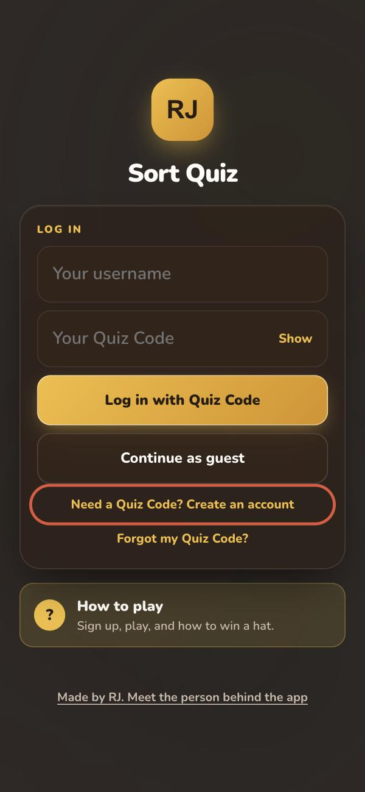

**Step 2.** Pick a **username**: 3 to 24 letters, numbers or `_`. Other players see it on the leaderboard. You can't change it later, so choose well. **You need it every time you log in.**
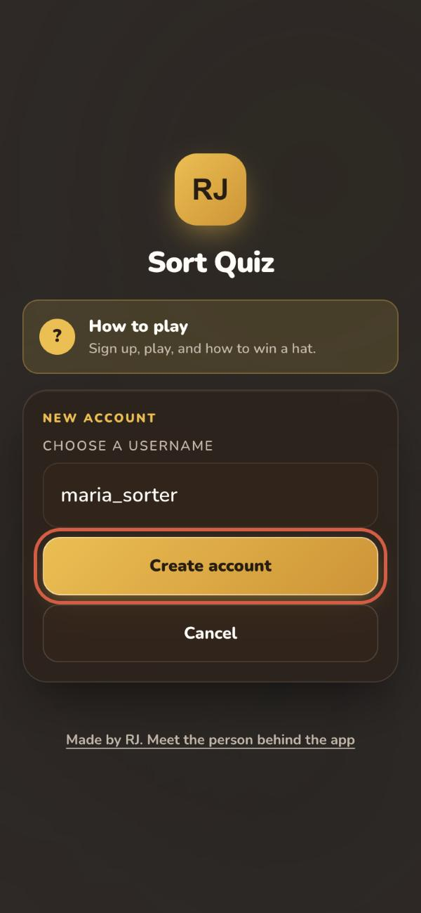

**Step 3.** The app shows your **Quiz Code**: one English word and two numbers, like **banana-48**. You log in with your **username** and this code. There is no password and no email.
- It is shown **one time only**.
- Take a photo of the screen or write down your **username and code** **now**.
- Tick **I saved my Quiz Code**, then tap **Continue**. You're in.
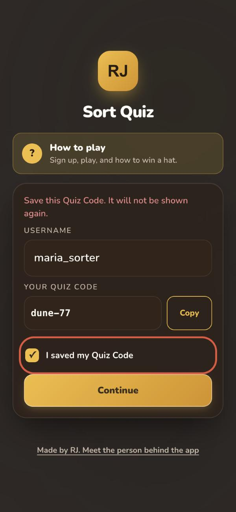

**Step 4. Next time you log in:** type your **username** and your **Quiz Code**, then tap **Log in with Quiz Code**. Your browser may offer to save them.
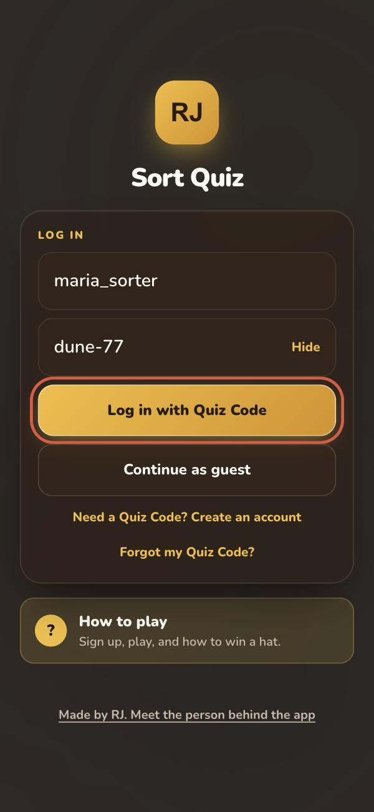

Your profile shows your **tag**, six letters and numbers like `#AB12CD`. It never changes. You'll need it to qualify for a hat (part 3).
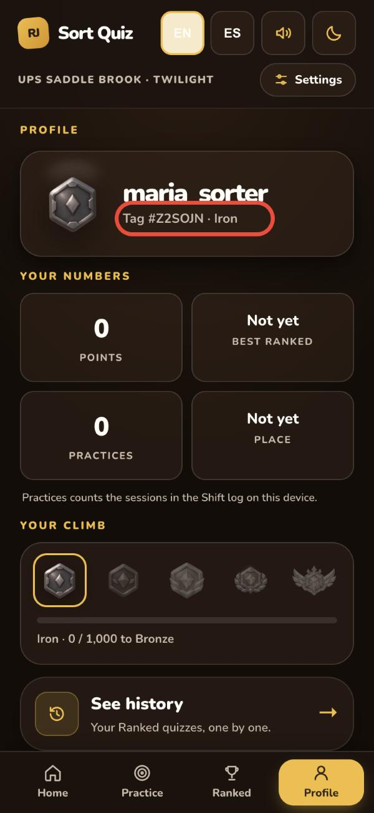

> We never ask for your real name, employee ID, phone or email.

---

## 2. Play

### Practice (no account needed)
Tap **Practice**, then **Take a quiz**, and pick a test. Each question gives you **15 seconds**: tap the belt color where the package goes. Practice **never** changes your points, so use it to learn the chart.
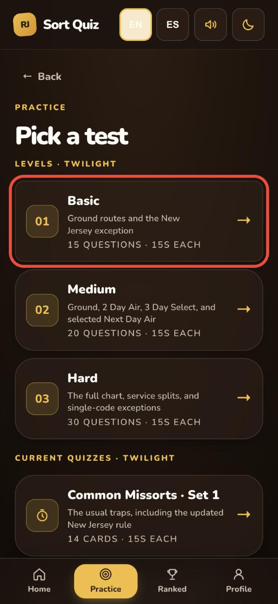 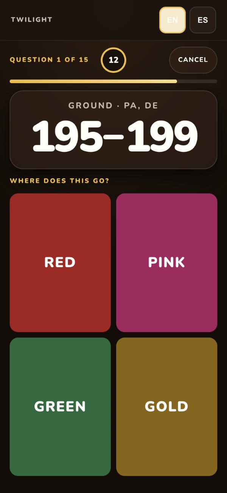

### Ranked (counts for points)
On Home tap **Play Ranked**, then **Start Ranked quiz**. You need to be logged in.
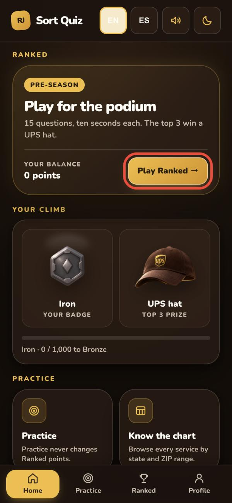 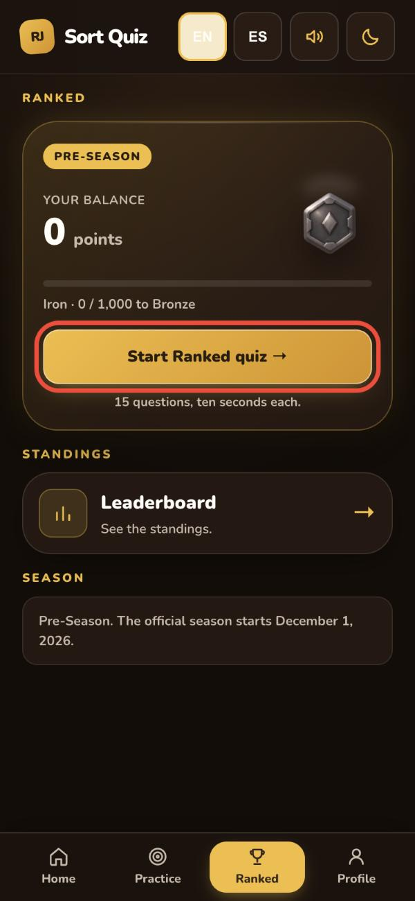
- **15 questions**: 5 Easy, 5 Medium, 5 Hard.
- **10 seconds** per question.
- Once you answer, it's locked. No going back.
- After each answer you see if you were right, then tap **Next**.
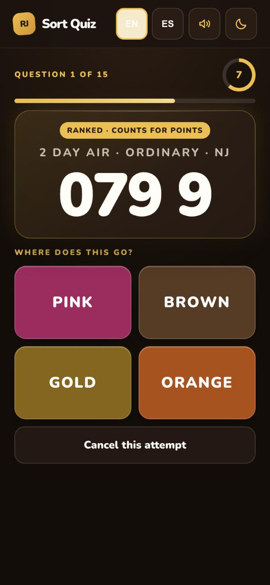 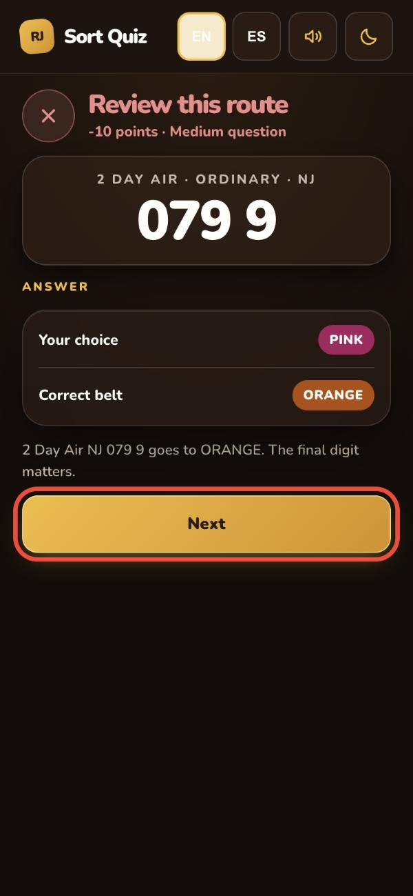

**Points per question**

| | Right | Wrong or time out |
|---|---|---|
| Easy | +10 | −15 |
| Medium | +20 | −10 |
| Hard | +30 | −5 |

Running out of time counts as wrong. At the end you see your score and your new balance.
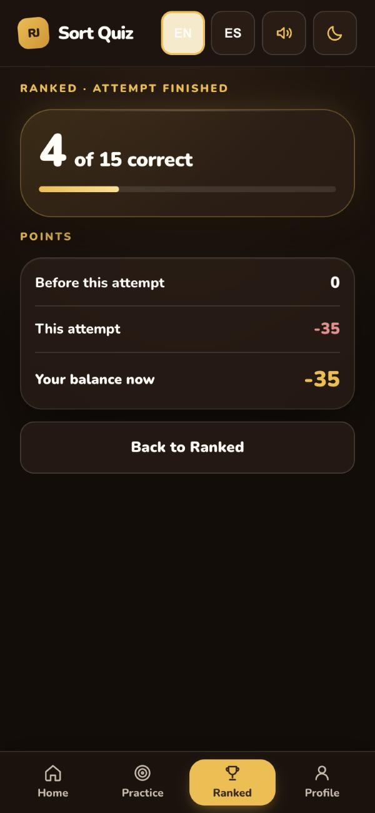

### Badges
| Badge | Points |
|---|---|
| Iron | up to 1,000 (it can go below 0) |
| Bronze | 1,001 – 2,000 |
| Silver | 2,001 – 3,000 |
| Gold | 3,001 – 4,000 |
| Challenger | 4,001 and up |

### Promotion
When you reach the top of your badge (1,000 / 2,000 / 3,000 / 4,000), normal Ranked stops. You get **Start promotion** instead.
- You need **15 out of 15**.
- Right answers add 0 points, wrong ones cost the usual points.
- 15/15 moves you up to the next badge.
- You choose when to start. Opening the screen does not start it.
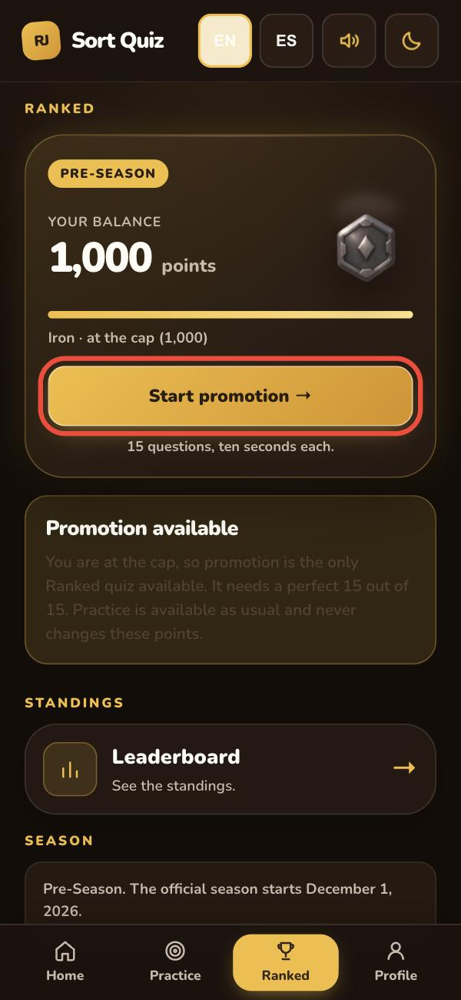

Losing points can drop you a badge.

### If something goes wrong
- **Quitting** a Ranked quiz (**Cancel this attempt**) costs an extra **−10**.
- **Your internet drops:** you have **15 seconds** to come back. The question clock keeps running. Reloading the page does **not** bring the quiz back.
- **The server itself goes down:** the quiz is cancelled. No points won or lost.
- **Something looks wrong?** Go to **Profile → Settings → Support → Create ticket**.
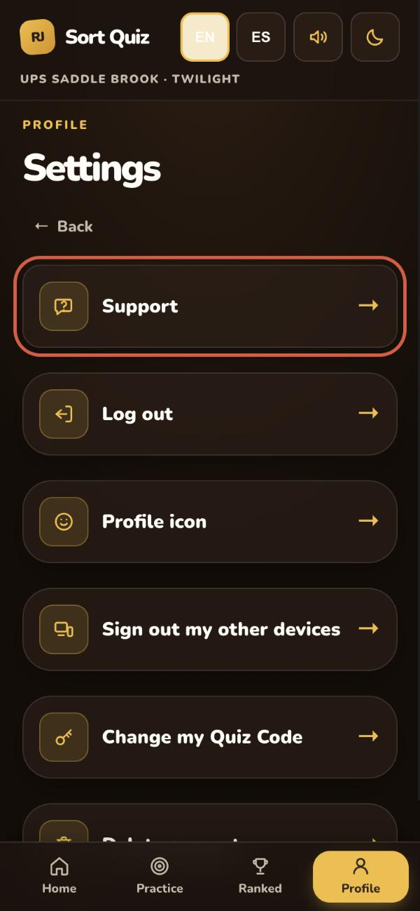 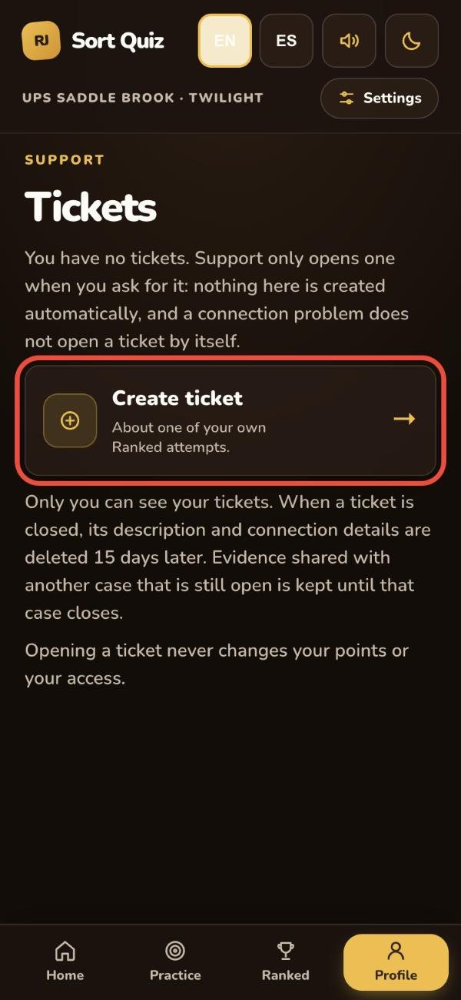

---

## 3. Win a UPS hat

**The season:** the official season runs **December 1, 2026, 12:00 a.m. Eastern** to **December 31, 2026, 11:59 p.m. Eastern**. On December 1, **everyone's Pre-Season points go back to 0**.

**The prize:** **3 UPS hats**, one for each of the top 3 players.

**Who can win:** anyone can play, but **only approved players can win a hat**.

**To be approved, you must be a sorter in Primary Sort, on the Twilight shift, at Saddle Brook.** If you work anywhere else, you can still play and climb, but you can't win a hat.

**How to get approved:**
1. Find the owner **in person at work**.
2. Tell them your **tag** (it's on your profile, like `#AB12CD`).
3. The owner confirms you're a Primary Sort Twilight sorter at Saddle Brook and approves **that one account**.
4. That account is yours for the prize for the whole season. You can't switch to another one later.

> One approved account and at most one hat per person. The owner approves privately. Nobody else sees your real name or ID.

**To win, you need all three:**
1. **Be approved**, as above.
2. **Before the deadline.** Approvals close when the season ends (December 31, 11:59 p.m. Eastern). Get approved early.
3. **Play.** Finish **at least one Ranked quiz** during the official season. Even a negative score counts. Pre-Season quizzes don't.

The competition leaderboard shows only qualified players. Everyone else can still play and see their own points.
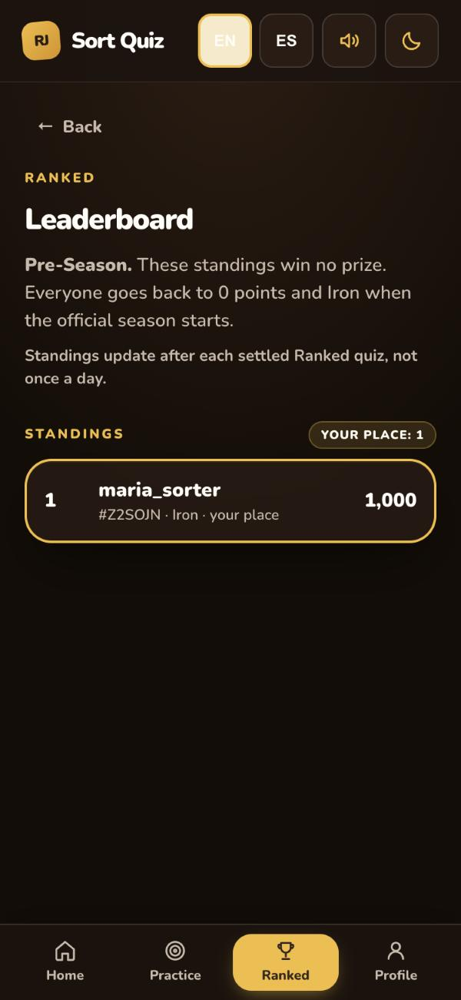

**Ties for a hat:** tied players play a **tie-break**. It's 5 Hard questions with only a few seconds each, open for **24 hours** after the season ends. You see your score only when the round closes. **If you don't play it, you can lose your place.**

---

## 4. FAQ

**I lost my Quiz Code. What now?**
There's no reset button. Tap **Forgot my Quiz Code?** to leave a message, then find the owner **in person at work**. They can give you a new code for the **same** account. Your points stay.

**Can I change my Quiz Code?**
Yes, while you are logged in: **Profile → Settings → Change my Quiz Code**. Type your current code, and you get a new one. The old one stops working at once. Codes from before still work too.
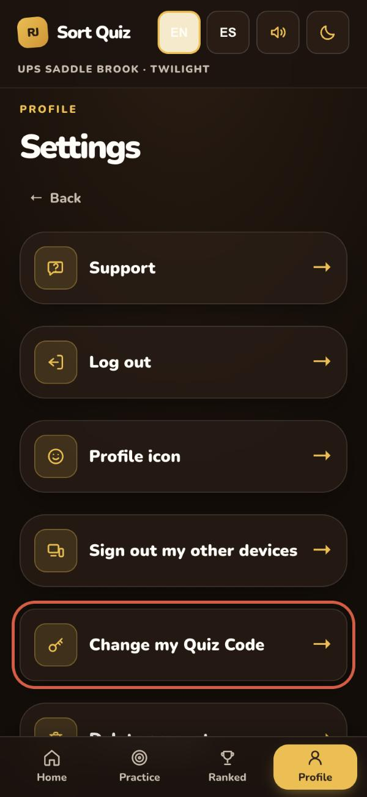

**I forgot my username.**
It's on your **profile** and beside your name in the app. If you're logged out, ask the owner **in person at work**; they can look it up.

**I'm not a Primary Sort Twilight sorter at Saddle Brook. Can I play?**
Yes. You can play, earn points and badges, and see your own place on your profile. You just can't be approved for a hat, so you won't appear on the competition leaderboard.

**Can I have two accounts?**
You can, but only the **one approved account** counts for a hat. Points never move between accounts.

**Do Practice points count?**
No. Practice never changes Ranked points.

**My internet dropped in the middle of a quiz. Did I lose points?**
You have 15 seconds to come back. After that the quiz ends and keeps the points you had at that moment. Questions you never saw don't cost anything.

**Why can't I start a normal Ranked quiz?**
You're at the top of your badge. Only **Start promotion** is available until you pass it or lose points.

**Why am I not on the leaderboard?**
You're not approved yet, or you haven't finished a Ranked quiz in the official season. See part 3.

**What happens to my Pre-Season points?**
They go back to 0 on December 1, 2026. Your Pre-Season history stays in your profile.

**When does the season end? What if there's a tie?**
December 31, 2026, 11:59 p.m. Eastern. A quiz already started gets 5 more minutes to finish. Ties for a hat go to a tie-break (part 3).

**Can I change my username?**
Not in the app today.

**How do I delete my account, and what do I lose?**
Go to **Profile → Settings → Delete account**. Your profile, history and points are erased. **You can't undo it.** You also leave this season's prize race for good.

---

<!-- NEW-PAGE -->
## 5. ZIP chart: every route in the Ranked quiz

This is every route the Ranked quiz can ask, by service. Next to each ZIP is the **belt** it goes to and how many **points** it's worth.

**Points come from the question's level, not from the belt color.** Each route has one level (Easy, Medium or Hard), and that level sets the points: right **+10 / +20 / +30**, wrong or time out **−15 / −10 / −5**.

How to read a ZIP:
- `070–089` is a range of the first three digits.
- `087 1` means the first three digits **plus the next one**.
- `890 0-0` is the full code as printed on the label.
- **ends 1S / 2S** means a code ending in those letters, in any state.

> In promotion quizzes a right answer adds 0 instead. Practice uses the same chart, but never changes points.

<!-- ZIP-TABLE -->
