# Sort Quiz — Cómo jugar

Abre **sortquiz.app** en tu teléfono. Esa es toda la app; no hay nada que instalar.

> La pantalla de inicio de sesión está casi toda en inglés; abajo te decimos qué botón tocar. Una vez dentro, toca **ES** arriba a la derecha para ver la app en español.

---

## 1. Crea tu cuenta

**Paso 1.** En la pantalla de inicio de sesión, toca **Need a Quiz Code? Create an account** (crear una cuenta).
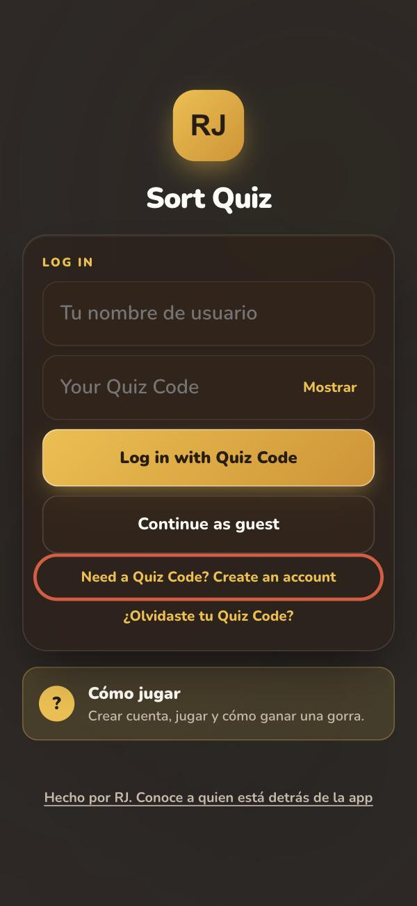

**Paso 2.** Elige un **nombre de usuario**: de 3 a 24 letras, números o `_`. Los demás jugadores lo ven en la clasificación. No se puede cambiar después, así que elige bien. Toca **Crear cuenta**.
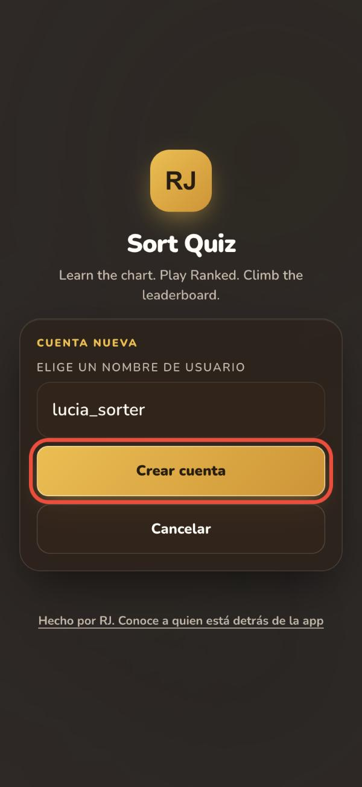

**Paso 3.** La app te muestra tu **Quiz Code**. Es la ÚNICA forma de entrar. No hay contraseña ni correo.
- Se muestra **una sola vez**.
- Tómale una foto o anótalo **ahora**.
- Marca **Guardé mi Quiz Code** y toca **Continuar**. Ya estás dentro.
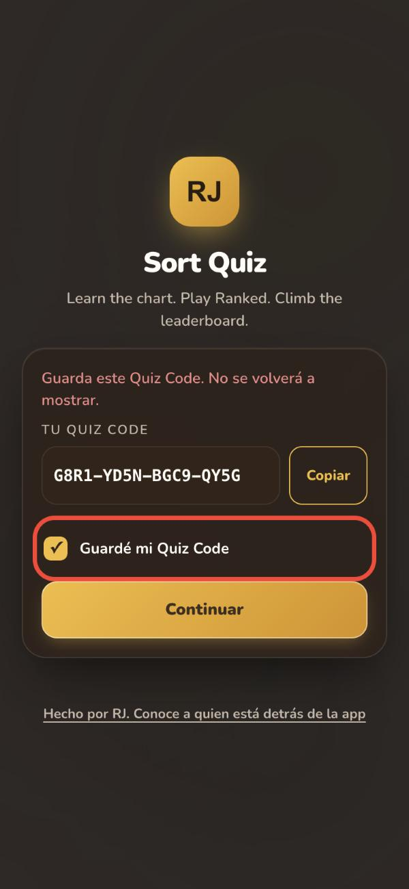

**Paso 4. La próxima vez que entres:** escribe tu Quiz Code y toca **Log in with Quiz Code** (entrar con Quiz Code).
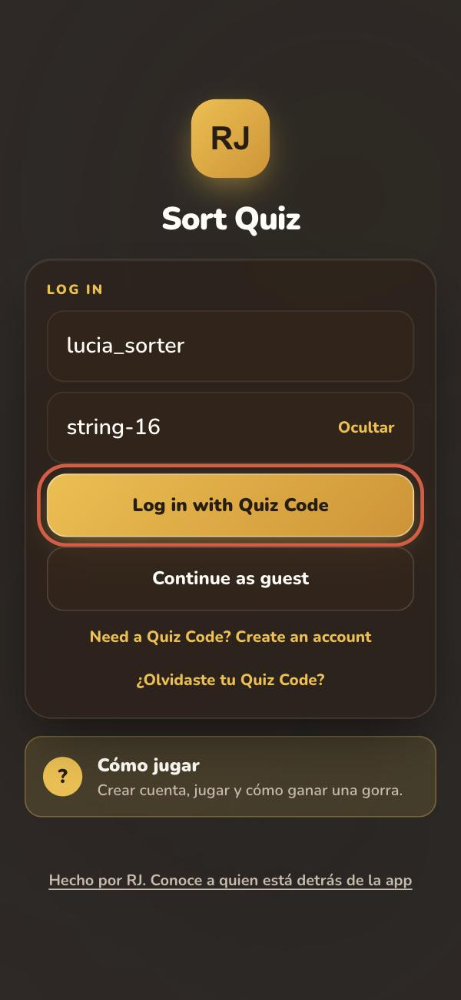

Tu perfil muestra tu **etiqueta**: seis letras y números, como `#AB12CD`. Nunca cambia. La necesitas para poder ganar una gorra (parte 3).
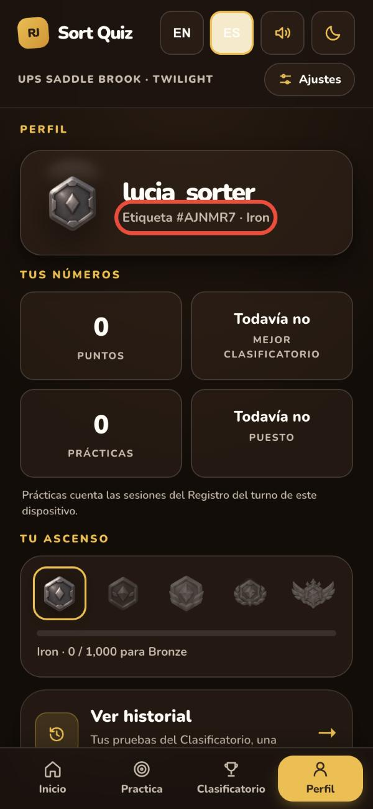

> Nunca pedimos tu nombre real, tu número de empleado, tu teléfono ni tu correo.

---

## 2. Juega

### Practica (no necesitas cuenta)
Toca **Practica**, luego **Haz una prueba**, y elige una prueba. Cada pregunta te da **15 segundos**: toca el color de la banda a la que va el paquete. La práctica **nunca** cambia tus puntos, así que úsala para aprender la tabla.
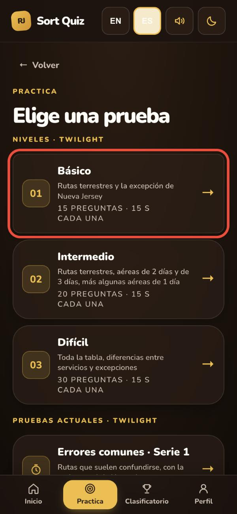 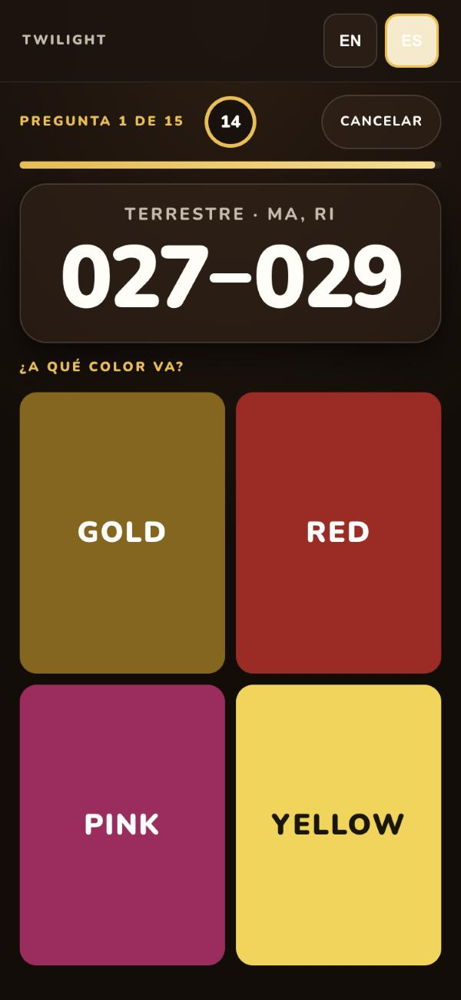

### Clasificatorio (cuenta para los puntos)
En Inicio toca **Jugar Clasificatorio** y luego **Empezar prueba del Clasificatorio**. Tienes que haber iniciado sesión.
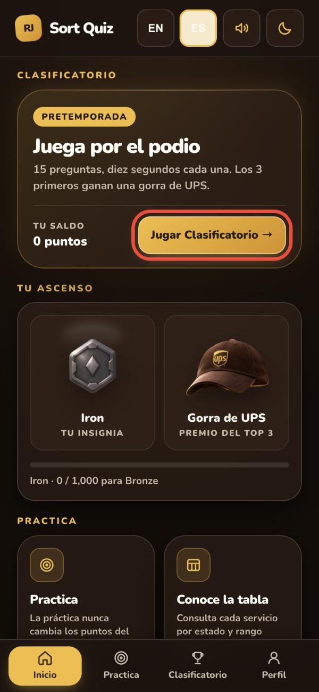 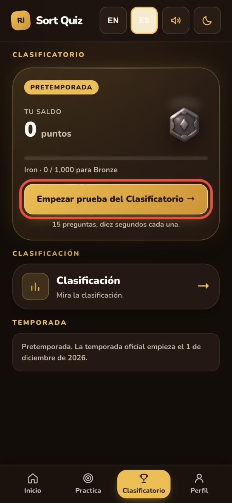
- **15 preguntas**: 5 fáciles, 5 intermedias, 5 difíciles.
- **10 segundos** por pregunta.
- Cuando respondes, queda fija. No se puede volver atrás.
- Después de cada respuesta ves si acertaste, y tocas **Siguiente**.
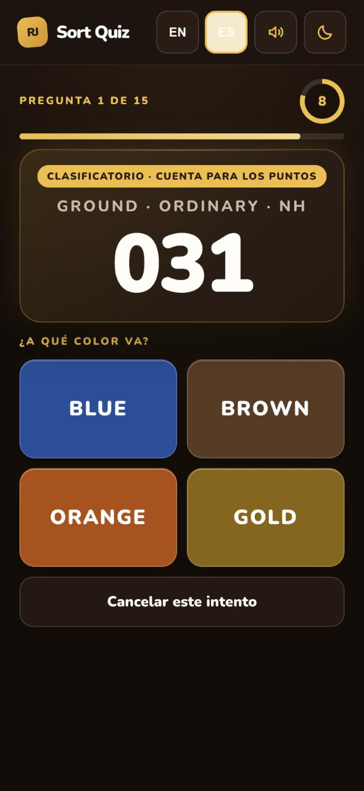 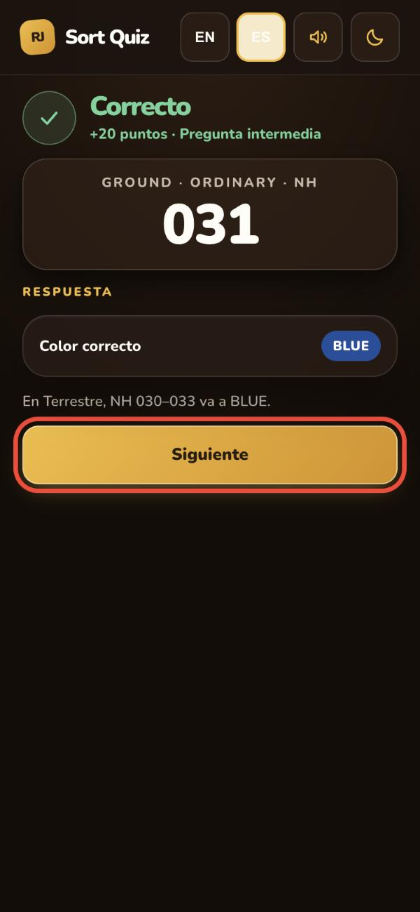

**Puntos por pregunta**

| | Correcta | Incorrecta o sin tiempo |
|---|---|---|
| Fácil | +10 | −15 |
| Intermedia | +20 | −10 |
| Difícil | +30 | −5 |

Si se acaba el tiempo, cuenta como incorrecta. Al final ves tu resultado y tu nuevo saldo.
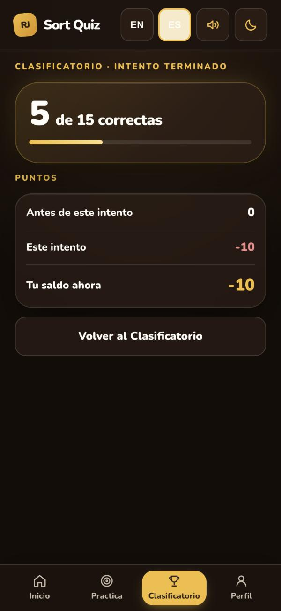

### Insignias
| Insignia | Puntos |
|---|---|
| Iron | hasta 1,000 (puede bajar de 0) |
| Bronze | 1,001 – 2,000 |
| Silver | 2,001 – 3,000 |
| Gold | 3,001 – 4,000 |
| Challenger | 4,001 o más |

### Ascenso
Cuando llegas al tope de tu insignia (1,000 / 2,000 / 3,000 / 4,000), el Clasificatorio normal se detiene. En su lugar aparece **Empezar el ascenso**.
- Necesitas **15 de 15**.
- Las respuestas correctas suman 0 puntos; las incorrectas restan lo de siempre.
- Con 15/15 subes a la siguiente insignia.
- Tú eliges cuándo empezar. Abrir la pantalla no lo empieza.
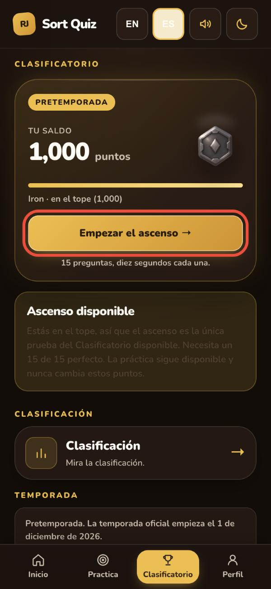

Si pierdes puntos, puedes bajar de insignia.

### Si algo sale mal
- **Salir** de una prueba del Clasificatorio (**Cancelar este intento**) resta **−10** extra.
- **Se cae tu internet:** tienes **15 segundos** para volver. El reloj de la pregunta sigue corriendo. Recargar la página **no** recupera la prueba.
- **Se cae el servidor:** la prueba se anula. No ganas ni pierdes puntos.
- **¿Algo se ve mal?** Ve a **Perfil → Ajustes → Soporte → Crear caso**.
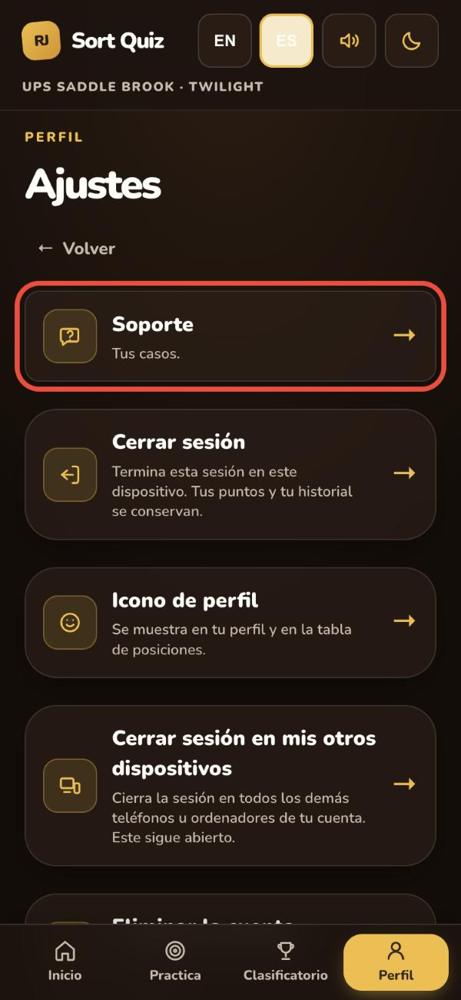 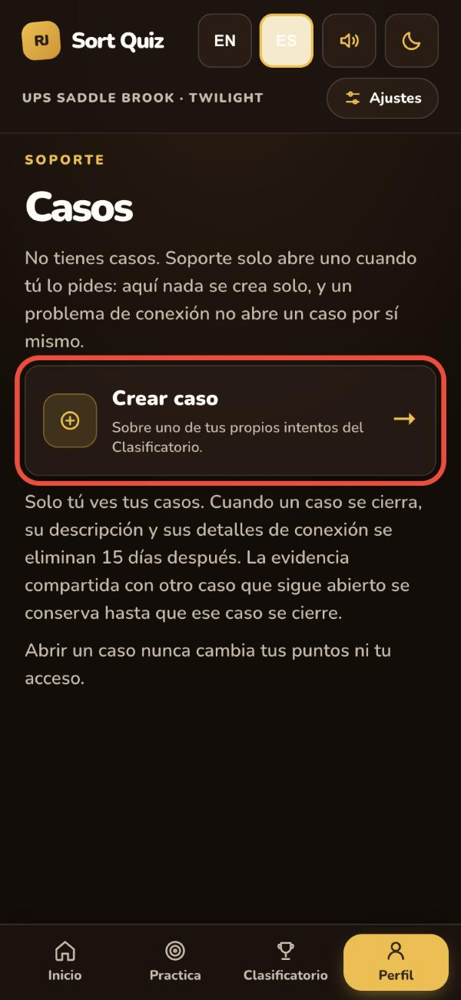

---

## 3. Gana una gorra de UPS

**La temporada:** la temporada oficial va del **1 de diciembre de 2026, 12:00 a.m. (hora del Este)** al **31 de diciembre de 2026, 11:59 p.m. (hora del Este)**. El 1 de diciembre **los puntos de la pretemporada de todos vuelven a 0**.

**El premio:** **3 gorras de UPS**, una para cada uno de los 3 primeros.

**Quién puede ganar:** cualquiera puede jugar, pero **solo los jugadores aprobados pueden ganar una gorra**.

**Para ser aprobado, tienes que ser sorter de Primary Sort, en el turno Twilight, en Saddle Brook.** Si trabajas en otra área, puedes jugar y subir igual, pero no puedes ganar una gorra.

**Cómo te aprueban:**
1. Busca al responsable **en persona en el trabajo**.
2. Dile tu **etiqueta** (está en tu perfil, como `#AB12CD`).
3. El responsable confirma que eres sorter de Primary Sort Twilight en Saddle Brook y aprueba **esa cuenta**.
4. Esa cuenta es la tuya para el premio durante toda la temporada. No puedes cambiarla por otra después.

> Una cuenta aprobada y como máximo una gorra por persona. El responsable aprueba en privado. Nadie más ve tu nombre real ni tu número.

**Para ganar, necesitas las tres cosas:**
1. **Estar aprobado**, como arriba.
2. **Antes del cierre.** Las aprobaciones se cierran cuando termina la temporada (31 de diciembre, 11:59 p.m., hora del Este). Hazlo pronto.
3. **Jugar.** Termina **al menos una prueba del Clasificatorio** durante la temporada oficial. Aunque saques puntos negativos, cuenta. Las pruebas de la pretemporada no cuentan.

La clasificación de la competencia muestra solo a los jugadores que cumplen. Los demás pueden seguir jugando y ver sus propios puntos.
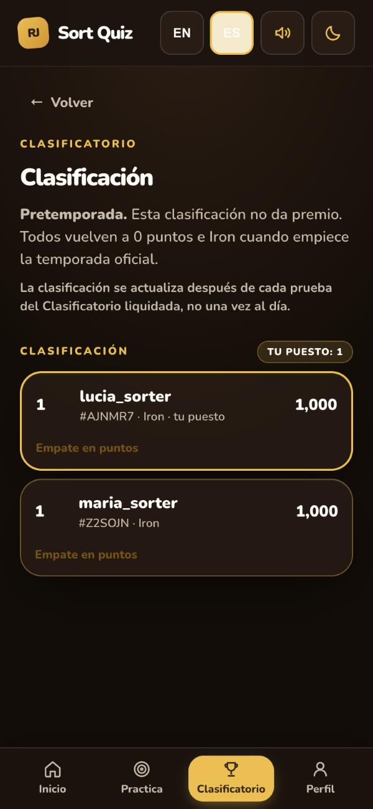

**Empates por una gorra:** los jugadores empatados juegan un **desempate**. Son 5 preguntas difíciles con muy pocos segundos cada una, abiertas durante **24 horas** después de que termina la temporada. Ves tu resultado solo cuando la ronda se cierra. **Si no lo juegas, puedes perder tu lugar.**

---

## 4. Preguntas frecuentes

**Perdí mi Quiz Code. ¿Qué hago?**
No hay botón para recuperarlo. Toca **¿Olvidaste tu Quiz Code?** para dejar un mensaje y luego busca al responsable **en persona en el trabajo**. Te puede dar un código nuevo para la **misma** cuenta. Tus puntos se mantienen.

**No soy sorter de Primary Sort Twilight en Saddle Brook. ¿Puedo jugar?**
Sí. Puedes jugar, ganar puntos e insignias y ver tu propio puesto en tu perfil. Solo que no te pueden aprobar para una gorra, así que no apareces en la clasificación de la competencia.

**¿Puedo tener dos cuentas?**
Puedes, pero solo **la cuenta aprobada** cuenta para una gorra. Los puntos nunca pasan de una cuenta a otra.

**¿Los puntos de la práctica cuentan?**
No. La práctica nunca cambia los puntos del Clasificatorio.

**Se cayó mi internet en medio de una prueba. ¿Perdí puntos?**
Tienes 15 segundos para volver. Después, la prueba termina y te quedas con los puntos que tenías en ese momento. Las preguntas que no viste no te restan nada.

**¿Por qué no puedo empezar una prueba normal del Clasificatorio?**
Estás en el tope de tu insignia. Solo está disponible **Empezar el ascenso** hasta que lo pases o pierdas puntos.

**¿Por qué no aparezco en la clasificación?**
Todavía no te aprobaron, o no has terminado una prueba del Clasificatorio en la temporada oficial. Mira la parte 3.

**¿Qué pasa con mis puntos de la pretemporada?**
Vuelven a 0 el 1 de diciembre de 2026. Tu historial de la pretemporada se queda en tu perfil.

**¿Cuándo termina la temporada? ¿Y si hay empate?**
El 31 de diciembre de 2026 a las 11:59 p.m., hora del Este. Una prueba ya empezada tiene 5 minutos más para terminar. Los empates por una gorra van a desempate (parte 3).

**¿Puedo cambiar mi nombre de usuario?**
Hoy no, desde la app no.

**¿Cómo elimino mi cuenta y qué pierdo?**
Ve a **Perfil → Ajustes → Eliminar la cuenta**. Se borran tu perfil, tu historial y tus puntos. **No se puede deshacer.** También sales para siempre de la competencia por los premios de esta temporada.

---

<!-- NEW-PAGE -->
## 5. Tabla de ZIP: todas las rutas del Clasificatorio

Estas son todas las rutas que puede preguntar el Clasificatorio, por servicio. Al lado de cada ZIP está la **banda** a la que va y cuántos **puntos** vale.

**Los puntos dependen del nivel de la pregunta, no del color de la banda.** Cada ruta tiene un nivel (Fácil, Intermedia o Difícil), y ese nivel define los puntos: correcta **+10 / +20 / +30**, incorrecta o sin tiempo **−15 / −10 / −5**.

Cómo leer un ZIP:
- `070–089` es un rango de los tres primeros dígitos.
- `087 1` son los tres primeros dígitos **más el siguiente**.
- `890 0-0` es el código completo como aparece en la etiqueta.
- **ends 1S / 2S** es un código que termina en esas letras, en cualquier estado.

> En las pruebas de ascenso, una respuesta correcta suma 0. La práctica usa la misma tabla, pero nunca cambia los puntos.

<!-- ZIP-TABLE -->
