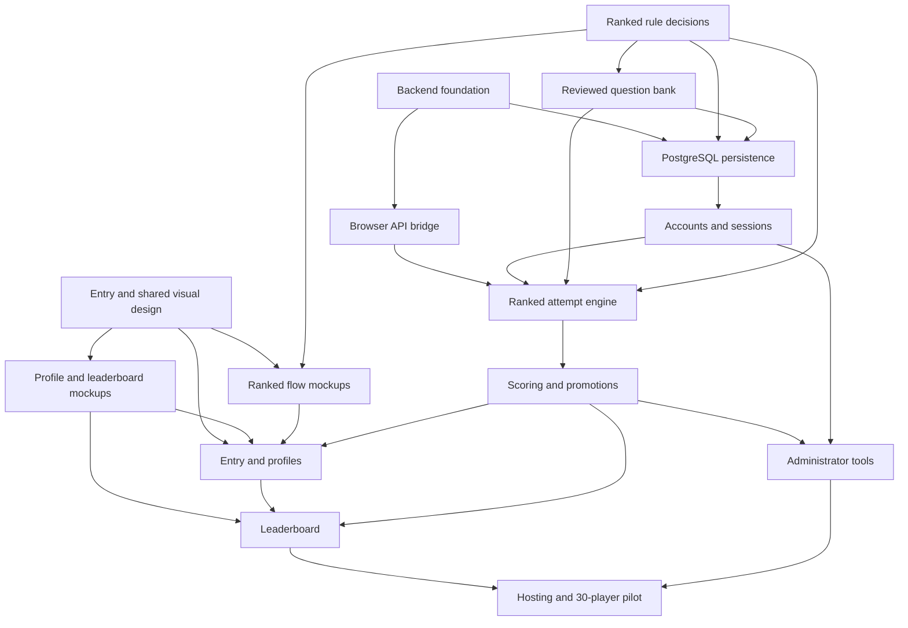

# Peak Season — incremental development roadmap

**Status:** Planning only. Issues are open; no backend feature is implemented by this documentation change.

**Related:** [[2026-11-06-ranked-pilot-design]].

## Start here

Open the [parent roadmap](https://github.com/renilsonjr/Sort-Tester-Live/issues/1). Each child issue contains its goal, build steps, decisions, acceptance checks, and native GitHub blocking dependencies. Work on one small deliverable at a time. Ask the owner one decision question at a time where a rule remains open.

This is the live application repository and the confirmed home for this expansion. Its main branch publishes through GitHub Pages; development branches do not. The current checkout has no backend or release-builder script. A focused security regression suite now runs locally and in GitHub Actions; broader Practice and backend checks remain part of the foundation work. Establish those foundations using the actual files in this repository.

The foundation, rule-decision, and shared navigation design issues can begin now. Do not treat the entire pilot as one coding task. A branch is source isolation; separate environment configuration and database data provide runtime isolation.

## Ordered issues

| Feature / issue | Blocked by |
| --- | --- |
| [01 · Establish the backend workspace and first health endpoint](https://github.com/renilsonjr/Sort-Tester-Live/issues/2) | None — ready to start |
| [02 · Connect a development browser page to the API](https://github.com/renilsonjr/Sort-Tester-Live/issues/3) | [#2](https://github.com/renilsonjr/Sort-Tester-Live/issues/2) |
| [03 · Resolve ranked attempt and promotion edge cases](https://github.com/renilsonjr/Sort-Tester-Live/issues/4) | None — ready to start |
| [04 · Review and version the ranked question bank](https://github.com/renilsonjr/Sort-Tester-Live/issues/5) | [#4](https://github.com/renilsonjr/Sort-Tester-Live/issues/4) |
| [05 · Persist users, question assignments, attempts, and ranking history](https://github.com/renilsonjr/Sort-Tester-Live/issues/6) | [#2](https://github.com/renilsonjr/Sort-Tester-Live/issues/2), [#4](https://github.com/renilsonjr/Sort-Tester-Live/issues/4), [#5](https://github.com/renilsonjr/Sort-Tester-Live/issues/5) |
| [06 · Add employee registration, sessions, and account access controls](https://github.com/renilsonjr/Sort-Tester-Live/issues/7) | [#6](https://github.com/renilsonjr/Sort-Tester-Live/issues/6) |
| [07 · Implement the server-authoritative ranked attempt engine](https://github.com/renilsonjr/Sort-Tester-Live/issues/8) | [#3](https://github.com/renilsonjr/Sort-Tester-Live/issues/3), [#4](https://github.com/renilsonjr/Sort-Tester-Live/issues/4), [#5](https://github.com/renilsonjr/Sort-Tester-Live/issues/5), [#6](https://github.com/renilsonjr/Sort-Tester-Live/issues/6), [#7](https://github.com/renilsonjr/Sort-Tester-Live/issues/7) |
| [08 · Apply ranked scores, caps, promotions, and demotions exactly once](https://github.com/renilsonjr/Sort-Tester-Live/issues/9) | [#4](https://github.com/renilsonjr/Sort-Tester-Live/issues/4), [#8](https://github.com/renilsonjr/Sort-Tester-Live/issues/8) |
| [09 · Build public entry, separate modes, and the employee profile](https://github.com/renilsonjr/Sort-Tester-Live/issues/10) | [#3](https://github.com/renilsonjr/Sort-Tester-Live/issues/3), [#7](https://github.com/renilsonjr/Sort-Tester-Live/issues/7), [#9](https://github.com/renilsonjr/Sort-Tester-Live/issues/9), [#15](https://github.com/renilsonjr/Sort-Tester-Live/issues/15), [#16](https://github.com/renilsonjr/Sort-Tester-Live/issues/16), [#17](https://github.com/renilsonjr/Sort-Tester-Live/issues/17) |
| [10 · Add administrator account management and performance review](https://github.com/renilsonjr/Sort-Tester-Live/issues/11) | [#7](https://github.com/renilsonjr/Sort-Tester-Live/issues/7), [#9](https://github.com/renilsonjr/Sort-Tester-Live/issues/9) |
| [11 · Display leaderboard totals and current rank badges](https://github.com/renilsonjr/Sort-Tester-Live/issues/12) | [#9](https://github.com/renilsonjr/Sort-Tester-Live/issues/9), [#10](https://github.com/renilsonjr/Sort-Tester-Live/issues/10), [#16](https://github.com/renilsonjr/Sort-Tester-Live/issues/16) |
| [12 · Validate the Windows server and prepare the 30-player pilot](https://github.com/renilsonjr/Sort-Tester-Live/issues/13) | [#10](https://github.com/renilsonjr/Sort-Tester-Live/issues/10), [#11](https://github.com/renilsonjr/Sort-Tester-Live/issues/11), [#12](https://github.com/renilsonjr/Sort-Tester-Live/issues/12) |

## Collaborative design track

| Design deliverable | Blocked by | Used by |
| --- | --- | --- |
| [Public entry, navigation, and shared visual style](https://github.com/renilsonjr/Sort-Tester-Live/issues/15) | None — can start now | Screen implementation |
| [Employee profile and leaderboard mockups](https://github.com/renilsonjr/Sort-Tester-Live/issues/16) | Shared navigation design | Profile and leaderboard implementation |
| [Ranked, promotion, feedback, and results mockups](https://github.com/renilsonjr/Sort-Tester-Live/issues/17) | Shared navigation design and ranked rule decisions for final states | Ranked screen implementation |

Review mobile mockups together using fictional data and record owner choices in each issue. Begin from the current app's visual style; agree on any changes before implementation. These issues produce reviewed design references, not production features. Backend foundation does not depend on aesthetic choices.

## Intended dependency flow

## How to work through an issue

1. Read the confirmed rules and the issue's decisions. Resolve only the decisions required for that deliverable.
2. Explain the next small change in plain language. Tell the owner before changing an existing file.
3. Implement on a dedicated development branch. Add meaningful checks for behavior and integrity risks.
4. Run the focused checks and existing Practice regression checks appropriate to the change.
5. Record evidence and remaining limitations in the issue/PR. Close an issue only when its acceptance checks pass.
6. Continue to an issue whose blockers are complete. Publishing the employee pilot is a distinct release step.

## Boundaries

- Reuse current Practice; preserve local logs/export and the 15-second timer.
- Ranked uses accounts, server-owned state, 10-second questions, reviewed difficulty, and auditable once-only settlement.
- Unlimited ranked retries are intentional. Multiple active attempts and interrupted promotions still need explicit rules.
- The pilot ends when the owner chooses; do not install an automatic reset schedule.
- Extra achievement criteria, matchmaking, and routine administrator score editing are outside the initial scope.
- Home server is a candidate, not a capacity guarantee. Verify 30 simultaneous players, recovery, and secure external access before rollout.
