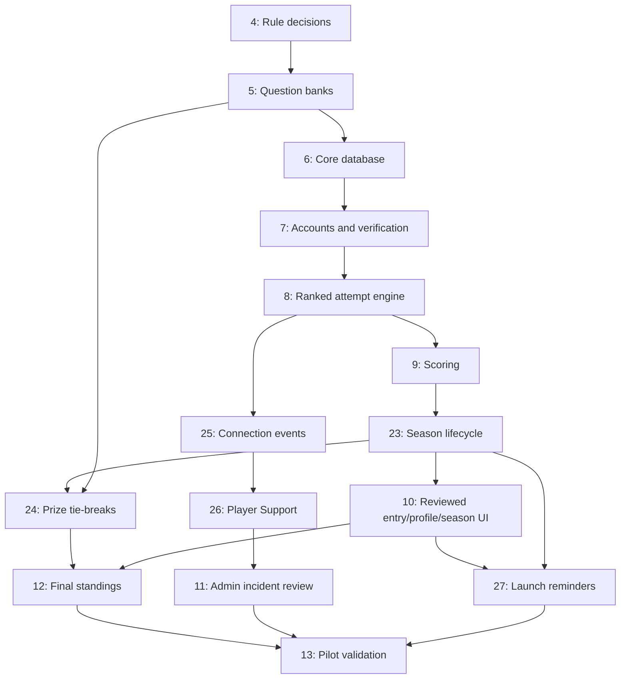

# Peak Season — incremental development roadmap

**Status:** Updated November 7, 2026. Backend health and browser/API foundations are complete; competition features remain planned.

**Related:** [[2026-11-07-ranked-decision-record]], [[2026-11-06-ranked-pilot-design]].

## Start here

Use parent roadmap [#1](https://github.com/renilsonjr/Sort-Tester-Live/issues/1), then the current decision record. This is the live application repository. Shared `codex/ranked-mode` keeps reviewed development away from main; separate runtime configuration/data is still required. Main publishes static files via Pages, not the API.

Closed foundations #2/#3 include health/CORS, local Windows startup/LAN/browser checks and 10 backend/23 Node tests. They do not prove accounts, PostgreSQL persistence or Ranked rules are implemented. Do not reopen them for this planning expansion.

Issue #4 remains open. Read [[2026-11-07-ranked-decision-record]]: Q1–Q7 are settled. Challenger uses at most three valid five-second rounds; lower ranks use at most five rounds at 5/5/5/4/3 seconds. Remaining completed-player ties at the limit or fresh-question exhaustion use owner selection. Challenger noncompletion/no-shows are automatically excluded from top-three prizes at the valid round deadline, with points/badges unchanged; lower-rank incomplete-group ordering keeps its manual fallback below completed players. Confirmed outage-voided rounds cannot trigger exclusion. First-reached-score fallback is superseded. Q14 backfill is approved: next eligible non-excluded players fill vacant prize places using frozen points and existing tie-break rules. Replacement tie groups get a fresh 24-hour window from round opening. Q14 is settled: if eligible replacements run out, award only available confirmed winners and leave the other hats unawarded. Q7 is settled: explicit Start promotion with a pre-start 15/15 explanation is the only Ranked option at a capped badge’s settled cap; Practice stays available. Below the cap ordinary Ranked remains available; Challenger has no cap/promotion gate. Q8 refresh non-resumption and finalization at the existing 15-second connection-loss deadline are settled; Ranked/promotion feedback now waits for Next before the next ten-second question. Tie-break questions auto-advance after accepted answers/timeouts with their existing round-specific timers and hidden feedback; no next question while disconnected. Only loss/outage/session enforcement and grace-start/cadence remain open in Q8. Q13 is settled: end unfinished Pre-Season Ranked/promotion attempts without applying scores, reset to 0/Iron/none, and preserve history in the owner-private profile tab “pre season history” with server-side ownership enforcement and no automatic admin exception (Q10 visibility settled); prevent late Pre-Season settlement from affecting official points. Resolve remaining affected Q8 policy before implementation; Q9 shared-evidence retention is settled: keep logs while any linked case is open, then delete 15 days after the last closure; case descriptions keep their own cleanup dates. Q10–Q12 stay with their owning issues. Non-prize tied-position numbering remains open in #12/#16. Preliminary mockups may show pending states; unapproved behavior must not be silently chosen.

## Issues and native blockers

This table records issue-completion dependencies. Work can be developed in smaller verified increments inside each issue. In particular, basic leaderboard and account work need not implement reminder delivery or Support first; final feature completion must satisfy its listed scope.

| Issue | State | Blocked by |
| --- | --- | --- |
| [#2](https://github.com/renilsonjr/Sort-Tester-Live/issues/2) · 01 · Establish the backend workspace and first health endpoint | Complete | None |
| [#3](https://github.com/renilsonjr/Sort-Tester-Live/issues/3) · 02 · Connect a development browser page to the API | Complete | None |
| [#4](https://github.com/renilsonjr/Sort-Tester-Live/issues/4) · 03 · Resolve ranked attempt and promotion edge cases | Open / planned | None |
| [#5](https://github.com/renilsonjr/Sort-Tester-Live/issues/5) · 04 · Review and version the ranked question bank | Open / planned | [#4](https://github.com/renilsonjr/Sort-Tester-Live/issues/4) |
| [#6](https://github.com/renilsonjr/Sort-Tester-Live/issues/6) · 05 · Persist users, question assignments, attempts, and ranking history | Open / planned | [#2](https://github.com/renilsonjr/Sort-Tester-Live/issues/2), [#4](https://github.com/renilsonjr/Sort-Tester-Live/issues/4), [#5](https://github.com/renilsonjr/Sort-Tester-Live/issues/5) |
| [#7](https://github.com/renilsonjr/Sort-Tester-Live/issues/7) · 06 · Add employee registration, sessions, and account access controls | Open / planned | [#6](https://github.com/renilsonjr/Sort-Tester-Live/issues/6) |
| [#8](https://github.com/renilsonjr/Sort-Tester-Live/issues/8) · 07 · Implement the server-authoritative ranked attempt engine | Open / planned | [#3](https://github.com/renilsonjr/Sort-Tester-Live/issues/3), [#4](https://github.com/renilsonjr/Sort-Tester-Live/issues/4), [#5](https://github.com/renilsonjr/Sort-Tester-Live/issues/5), [#6](https://github.com/renilsonjr/Sort-Tester-Live/issues/6), [#7](https://github.com/renilsonjr/Sort-Tester-Live/issues/7) |
| [#9](https://github.com/renilsonjr/Sort-Tester-Live/issues/9) · 08 · Apply ranked scores, caps, promotions, and demotions exactly once | Open / planned | [#4](https://github.com/renilsonjr/Sort-Tester-Live/issues/4), [#8](https://github.com/renilsonjr/Sort-Tester-Live/issues/8) |
| [#10](https://github.com/renilsonjr/Sort-Tester-Live/issues/10) · 09 · Build public entry, separate modes, and the employee profile | Open / planned | [#3](https://github.com/renilsonjr/Sort-Tester-Live/issues/3), [#7](https://github.com/renilsonjr/Sort-Tester-Live/issues/7), [#9](https://github.com/renilsonjr/Sort-Tester-Live/issues/9), [#15](https://github.com/renilsonjr/Sort-Tester-Live/issues/15), [#16](https://github.com/renilsonjr/Sort-Tester-Live/issues/16), [#17](https://github.com/renilsonjr/Sort-Tester-Live/issues/17), [#23](https://github.com/renilsonjr/Sort-Tester-Live/issues/23), [#26](https://github.com/renilsonjr/Sort-Tester-Live/issues/26) |
| [#11](https://github.com/renilsonjr/Sort-Tester-Live/issues/11) · 10 · Add administrator account management and performance review | Open / planned | [#7](https://github.com/renilsonjr/Sort-Tester-Live/issues/7), [#9](https://github.com/renilsonjr/Sort-Tester-Live/issues/9), [#25](https://github.com/renilsonjr/Sort-Tester-Live/issues/25), [#26](https://github.com/renilsonjr/Sort-Tester-Live/issues/26) |
| [#12](https://github.com/renilsonjr/Sort-Tester-Live/issues/12) · 11 · Display leaderboard totals and current rank badges | Open / planned | [#9](https://github.com/renilsonjr/Sort-Tester-Live/issues/9), [#10](https://github.com/renilsonjr/Sort-Tester-Live/issues/10), [#16](https://github.com/renilsonjr/Sort-Tester-Live/issues/16), [#23](https://github.com/renilsonjr/Sort-Tester-Live/issues/23), [#24](https://github.com/renilsonjr/Sort-Tester-Live/issues/24) |
| [#13](https://github.com/renilsonjr/Sort-Tester-Live/issues/13) · 12 · Validate the Windows server and prepare the 30-player pilot | Open / planned | [#10](https://github.com/renilsonjr/Sort-Tester-Live/issues/10), [#11](https://github.com/renilsonjr/Sort-Tester-Live/issues/11), [#12](https://github.com/renilsonjr/Sort-Tester-Live/issues/12), [#23](https://github.com/renilsonjr/Sort-Tester-Live/issues/23), [#24](https://github.com/renilsonjr/Sort-Tester-Live/issues/24), [#25](https://github.com/renilsonjr/Sort-Tester-Live/issues/25), [#26](https://github.com/renilsonjr/Sort-Tester-Live/issues/26), [#27](https://github.com/renilsonjr/Sort-Tester-Live/issues/27) |
| [#15](https://github.com/renilsonjr/Sort-Tester-Live/issues/15) · Design · Mock public entry, mode navigation, and shared visual style | Open / planned | None |
| [#16](https://github.com/renilsonjr/Sort-Tester-Live/issues/16) · Design · Mock employee profile and leaderboard views | Open / planned | [#15](https://github.com/renilsonjr/Sort-Tester-Live/issues/15), [#4](https://github.com/renilsonjr/Sort-Tester-Live/issues/4) |
| [#17](https://github.com/renilsonjr/Sort-Tester-Live/issues/17) · Design · Mock Ranked questions, promotion, feedback, and results | Open / planned | [#15](https://github.com/renilsonjr/Sort-Tester-Live/issues/15), [#4](https://github.com/renilsonjr/Sort-Tester-Live/issues/4) |
| [#23](https://github.com/renilsonjr/Sort-Tester-Live/issues/23) · Season launch, reset, closing and final settlement | Open / planned | [#4](https://github.com/renilsonjr/Sort-Tester-Live/issues/4), [#6](https://github.com/renilsonjr/Sort-Tester-Live/issues/6), [#8](https://github.com/renilsonjr/Sort-Tester-Live/issues/8), [#9](https://github.com/renilsonjr/Sort-Tester-Live/issues/9) |
| [#24](https://github.com/renilsonjr/Sort-Tester-Live/issues/24) · Prize tie-break quizzes and 24-hour rounds | Open / planned | [#4](https://github.com/renilsonjr/Sort-Tester-Live/issues/4), [#5](https://github.com/renilsonjr/Sort-Tester-Live/issues/5), [#6](https://github.com/renilsonjr/Sort-Tester-Live/issues/6), [#7](https://github.com/renilsonjr/Sort-Tester-Live/issues/7), [#8](https://github.com/renilsonjr/Sort-Tester-Live/issues/8), [#9](https://github.com/renilsonjr/Sort-Tester-Live/issues/9), [#17](https://github.com/renilsonjr/Sort-Tester-Live/issues/17), [#23](https://github.com/renilsonjr/Sort-Tester-Live/issues/23) |
| [#25](https://github.com/renilsonjr/Sort-Tester-Live/issues/25) · Server connection events and non-punitive flags | Open / planned | [#4](https://github.com/renilsonjr/Sort-Tester-Live/issues/4), [#6](https://github.com/renilsonjr/Sort-Tester-Live/issues/6), [#8](https://github.com/renilsonjr/Sort-Tester-Live/issues/8) |
| [#26](https://github.com/renilsonjr/Sort-Tester-Live/issues/26) · Player Support tickets and 15-day closed retention | Open / planned | [#6](https://github.com/renilsonjr/Sort-Tester-Live/issues/6), [#7](https://github.com/renilsonjr/Sort-Tester-Live/issues/7), [#25](https://github.com/renilsonjr/Sort-Tester-Live/issues/25), [#15](https://github.com/renilsonjr/Sort-Tester-Live/issues/15), [#16](https://github.com/renilsonjr/Sort-Tester-Live/issues/16) |
| [#27](https://github.com/renilsonjr/Sort-Tester-Live/issues/27) · Verified opt-in launch reminder delivery and retries | Open / planned | [#7](https://github.com/renilsonjr/Sort-Tester-Live/issues/7), [#10](https://github.com/renilsonjr/Sort-Tester-Live/issues/10), [#23](https://github.com/renilsonjr/Sort-Tester-Live/issues/23) |

## Build sequence

1. Record settled rules and resolve required open cases in #4; review question labels/versions and Hard work-methods content in #5. Shared navigation design #15 can proceed with fictional data.
2. Implement/test core persistence #6, account/security/email verification contracts #7, attempt engine #8 and scoring #9. Feature-specific migrations follow their own issues; do not put all future features into the first migration.
3. Add season orchestration #23 and connection events/flags #25 using core contracts. Finalize profile/Ranked/tie-break designs #16/#17 from approved policy.
4. Integrate reviewed entry/profile/season UI #10; player Support #26 and administrative account/incident tools #11 are separately verified increments.
5. Implement prize tie-break rounds #24 and final leaderboard integration #12. Basic standings can be tested earlier, but final prizes need both lifecycle and tie-break outcomes.
6. Deliver launch reminders #27 using verified-email/consent and season contracts. Provider and uncertain-delivery handling remain explicit decisions. Any launch-scope deferral needs owner approval.
7. Complete hosting/recovery/backup/access and 30-player validation in #13 before employee rollout; public publication is a separate reviewed step.

## Dependency boundaries

The table/native relationships are the complete dependency list; the diagram is a simplified overview. Later orchestration consumes core contracts and must not become a prerequisite of those same core contracts.

## Work and verification rules

- Explain the next small change before editing existing files. Keep the owner's learning pace and use one focused decision question at a time.
- Use [[2026-11-07-ranked-decision-record]] as the settled source; preserve its Q1–Q14 register and explicit superseded proposals.
- Preserve current guest Practice, timing, local results and export. No routine administrator point editing, hidden MMR, extra achievements or separate points balance.
- Use reviewed fictional-data mockups in #15/#16/#17; do not implement visual assumptions as if approved.
- Test meaningful normal/failure/race/boundary cases and record exactly what ran on Mac, Windows, browser and hosted CI. Do not call a future rule implemented because foundation tests pass.
- Close only issues whose acceptance checks pass. Keep raw quiz performance and applied rank adjustments auditable, protect private contacts/Support data, and enforce authorization server-side.
- Official launch date is unknown; close is December 31, 2026 at 11:59 p.m. America/New_York. No January start is authorized. The Windows 11/16 GB server is a candidate, not a 30-player capacity guarantee.
