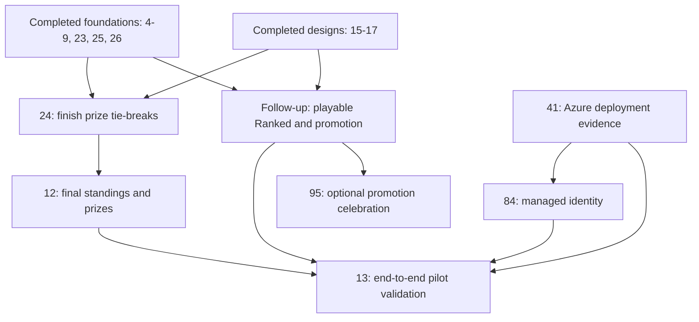

# Peak Season — incremental development roadmap

**Status:** Updated November 15, 2026 against GitHub issue states and the merged `codex/ranked-mode` source at `65c080d` (PR #143). A closed issue records its accepted scope; it does not by itself prove deployment or end-to-end play.

**Related:** [[2026-11-07-ranked-decision-record]], [[2026-11-07-ranked-security-operations-design]], [[2026-11-06-ranked-pilot-design]].

## Start here

Parent roadmap [#1](https://github.com/renilsonjr/Sort-Tester-Live/issues/1) tracks the current work. The decision record controls product rules. Earlier proposals in historical plans remain historical wherever those rules supersede them.

The application is a modular monolith: FastAPI serves the frontend and `/api` from one origin, with PostgreSQL. Development targets `codex/ranked-mode` and Azure Container Apps. GitHub Pages serves `main`; changes to the monolith branch do not publish the Pages application. A merge is not evidence that the hosted image or database has been updated.

## Completed issues

These issues are closed as completed. Keep their verification history in their own issues and PRs rather than reopening them for unrelated work.

| Issue | Completed scope |
| --- | --- |
| [#2](https://github.com/renilsonjr/Sort-Tester-Live/issues/2) | Backend health and local startup checks. |
| [#3](https://github.com/renilsonjr/Sort-Tester-Live/issues/3) | Development browser/API bridge and Practice regression checks. |
| [#4](https://github.com/renilsonjr/Sort-Tester-Live/issues/4) | Reviewed Ranked rules and protocol examples; a requirements milestone. |
| [#5](https://github.com/renilsonjr/Sort-Tester-Live/issues/5) | Reviewed, versioned route question bank. |
| [#6](https://github.com/renilsonjr/Sort-Tester-Live/issues/6) | PostgreSQL foundations and migrations. |
| [#7](https://github.com/renilsonjr/Sort-Tester-Live/issues/7) | Login-ID authentication and server-side sessions. |
| [#8](https://github.com/renilsonjr/Sort-Tester-Live/issues/8) | Server-authoritative normal/promotion attempt engine. |
| [#9](https://github.com/renilsonjr/Sort-Tester-Live/issues/9) | Scoring, caps and exactly-once settlement. |
| [#10](https://github.com/renilsonjr/Sort-Tester-Live/issues/10) | Entry, modes, profile, history, deletion, Support and session screens. Ranked play is still a follow-up; see the gap below. |
| [#11](https://github.com/renilsonjr/Sort-Tester-Live/issues/11) | Owner eligibility, in-person recovery, private case review and recent login-ID reauthentication. |
| [#15](https://github.com/renilsonjr/Sort-Tester-Live/issues/15) | Entry/navigation design. |
| [#16](https://github.com/renilsonjr/Sort-Tester-Live/issues/16) | Profile, leaderboard, deletion and Support design. |
| [#17](https://github.com/renilsonjr/Sort-Tester-Live/issues/17) | Ranked, promotion, connection and tie-break design. |
| [#23](https://github.com/renilsonjr/Sort-Tester-Live/issues/23) | Season lifecycle, launch/reset, close and settlement. |
| [#25](https://github.com/renilsonjr/Sort-Tester-Live/issues/25) | Connection events and non-punitive review flags. |
| [#26](https://github.com/renilsonjr/Sort-Tester-Live/issues/26) | Private Support tickets and shared-evidence retention. |
| [#47](https://github.com/renilsonjr/Sort-Tester-Live/issues/47) | Authentication follow-ups, including owner bootstrap and deletion. |
| [#75](https://github.com/renilsonjr/Sort-Tester-Live/issues/75) | Production migration command. |
| [#76](https://github.com/renilsonjr/Sort-Tester-Live/issues/76) | Production image. |
| [#77](https://github.com/renilsonjr/Sort-Tester-Live/issues/77) | Same-origin write protection. |
| [#78](https://github.com/renilsonjr/Sort-Tester-Live/issues/78) | Client-address handling behind ingress. |
| [#97](https://github.com/renilsonjr/Sort-Tester-Live/issues/97) | Email-storage cleanup, including the emails and outbox tables (migration 0021). |

## Withdrawn work

- **#27 — email launch reminder: closed as not planned.** The owner withdrew email collection and delivery on November 14. There is no email verification, consent, queued-mail cancellation or sending feature to build. #97 completed the storage cleanup. The replacement is the in-app season-start callout, shown only after a start is confirmed. Recovery uses in-person verification with the owner and a new login ID.
- **#55 — separate work-methods question bank: closed as not planned.** The November 15 decision in PR #136 uses the **53 approved Hard route questions** from #5 for tie-breaks. #24 owns fresh shared five-question sets, non-reuse and the owner fallback when no fresh set remains. There is no separate bank blocking it.

These withdrawals are not implemented features and must not be presented as completed email or work-methods delivery.

## Open work and remaining dependencies

| Work | Current state | Remaining prerequisite or next step |
| --- | --- | --- |
| #24 · Prize tie-breaks | Open; backend slices 1–6 merged in PRs #137, #138, #140–#143 | Its listed prerequisite issues are closed. Finish the player screens and verify the remaining acceptance criteria; merged slices do not close the whole issue. |
| Ranked/promotion browser play | Integration gap after closed #10 | The merged `src/app.js` start button still displays “Playing a Ranked quiz is being built. Nothing has started.” Track and finish the browser attempt lifecycle before claiming playable Ranked or a complete end-to-end pilot. Reuse the server engine from #8/#9. |
| #12 · Final leaderboard and prizes | Open; basic endpoint and screen merged in #125/#126 | #24 remains open. Integrate relative tie order, removal/backfill, replacement rounds and fewer-winner outcomes. |
| #41 · Azure hosting evidence | Open | Reconcile the older API-spike checklist with the chosen Container Apps monolith; verify deployment and actual cost evidence. |
| #84 · Managed identity for PostgreSQL | Open | Needs the hosted app from #41; should land before employee data under #13. |
| #13 · Azure host and 30-player pilot | Open | Remaining native blockers: #12, #24, #41 and #84. Complete Ranked play, hosting/security, monitoring, deletion-safe backups/restore and measured load evidence. #27 is withdrawn and is no longer a prerequisite. |
| #95 · Promotion celebration | Open; optional enhancement | Depends on authenticated playable promotion and its canonical result. Closed #10 does not remove the integration gap. This is not a pilot or hosting release gate. |
| Quiz-only avatar animation | Pending implementation | The app uses still renders. Keep this separate from the already merged visual refresh; connect motion to the actual quiz lifecycle and respect reduced motion. |

The checked/unchecked state of each acceptance criterion stays in its owning issue. An open issue with merged slices remains open until every required part has evidence.

## Next work sequence

1. Finish #24's player flow and acceptance checks. Local uncommitted work is not a delivered slice.
2. Complete normal Ranked/promotion browser play using the existing server engine. Give the #10 follow-up an explicit tracking home before implementation; include the original-page capability, heartbeat/grace, locked answers, server deadlines, Quit and canonical results.
3. Finish #12's prize standings against #24's outcomes, including deletion, exclusion, backfill and replacement ties.
4. In parallel with feature work, reconcile #41 and implement #84 before real employee data. The target is the Azure monolith; Windows development checks are not the hosting plan.
5. Complete #13's monitoring, backup/restore, failure, privacy and 30-player load checks. Review rollout and rollback evidence and obtain separate public rollout authorization.
6. Schedule #95 and quiz-only avatar animation alongside or after the required integration. Do not silently turn optional visual work into a new pilot gate.

## Dependency overview

This diagram shows the remaining sequence, not a claim that every edge is a native GitHub blocker. Closed prerequisite issues remain historical evidence; #27 and #55 do not block new work.

## Work and verification rules

- Explain changes to existing files before editing, preserve the owner's work in progress, and review small increments.
- Use [[2026-11-07-ranked-decision-record]] for settled rules and explicitly superseded proposals.
- Preserve guest Practice, its timing, local results and export. No routine owner point editing, hidden MMR or separate points balance.
- Use the reviewed mockups in #15/#16/#17. UI prototypes, merged code, deployed images and verified pilot behavior are distinct milestones.
- Record what actually ran: local unit tests, database-backed integration tests, hosted CI, browser walkthroughs and deployment checks. Skipped database tests do not establish PostgreSQL integration.
- Mark acceptance boxes only when every part is complete and merged. Preserve raw performance and applied score adjustments and enforce account/privacy boundaries on the server.
- No email collection or delivery remains in scope. Keep historical migrations and superseded policy text identifiable as history.
- The first official launch date remains undecided. Scheduled close is December 31, 2026 at 11:59 p.m. America/New_York. Load and recovery targets need measured evidence before rollout.
